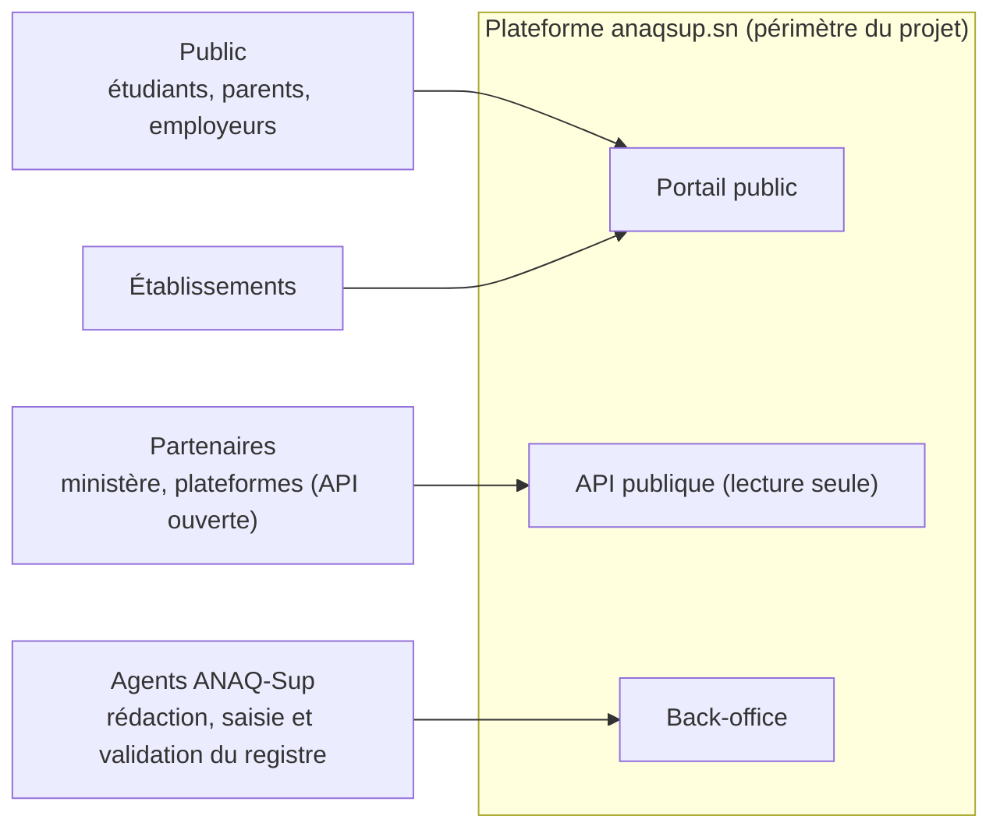
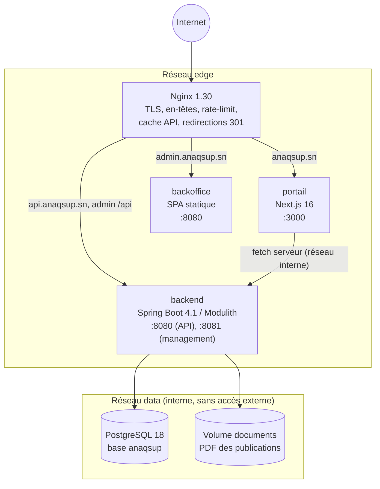
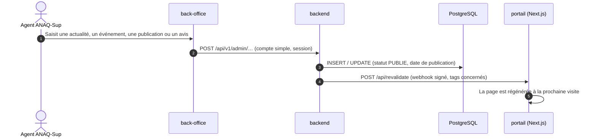

# Vue d'ensemble de l'architecture

## 1. Contexte (C4, niveau 1)

> e-ANAQ est un système distinct, hors du périmètre : la plateforme anaqsup.sn n'en dépend pas.

## 2. Conteneurs (C4, niveau 2)

## 3. Publication d'un contenu (publication directe)

## 4. Plan de nommage DNS

| Hôte | Cible | Exposition |
|---|---|---|
| `anaqsup.sn` | portail | Public |
| `www.anaqsup.sn` | redirection 301 vers `anaqsup.sn` | Public |
| `api.anaqsup.sn` | backend `/api/v1/public/**`, documentation OpenAPI | Public, avec limitation de débit |
| `admin.anaqsup.sn` | back-office + `/api/**` | **Restreint** (IP/VPN), comptes simples |
| `staging.anaqsup.sn`, `api-staging.…`, `admin-staging.…` | Recette | Restreint (IP) et `noindex` |

## 5. Environnements

| | dev | staging | production |
|---|---|---|---|
| Déclencheur | poste du développeur | push sur `main` | tag `vX.Y.Z` avec approbation |
| Données | jeu de démonstration | copie anonymisée de la production | réelles |
| Indexation | — | `X-Robots-Tag: noindex` | oui |
| Fichier d'environnement | `devops/env/dev.env.example` | `/opt/anaqsup/shared/staging.env` | `/opt/anaqsup/shared/production.env` |

## 6. Modules du backend (Spring Modulith)

| Module | Responsabilité | Dépend de |
|---|---|---|
| `shared` | Erreurs RFC 9457, pagination, sécurité, configuration web | — (module ouvert) |
| `content` | Actualités et catégories, événements, publications, pages institutionnelles (publication directe) | `shared` |
| `referentiel` | Habilitations (établissements) et accréditations (formations) : avis et année saisis tels quels, recherche | `shared` |
| `statistics` | Nombre d'avis favorables | `referentiel`, `shared` |
| `integration` | Reprise WordPress, webhook de revalidation du portail | — |
| `audit` | Journal des actions sensibles (optionnel, à confirmer) | — |

Les frontières sont **vérifiées par un test** (`ModularityTests`). Une dépendance non déclarée fait échouer la CI.
